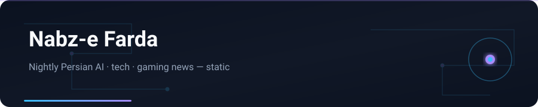

<p align="center">
  <a href="https://nabz-farda.vercel.app"></a>
</p>

<h1 align="center">نبض فردا · Nabz-e Farda</h1>

<p align="center">
  
</p>

<p align="center">
  <a href="#english">English</a> · <a href="#فارسی">فارسی</a>
</p>


<p align="center">
  <em>English AI, tech, and gaming news — rewritten in Persian every night, shipped as a fully static site.</em>
</p>

<p align="center">
  <a href="https://nabz-farda.vercel.app"><strong>Live site</strong></a>
  ·
  <a href="https://nabz-farda.vercel.app/about/"><strong>About / judges</strong></a>
  ·
  <a href="https://nabz-farda.vercel.app/automation/"><strong>Automation</strong></a> <sub>(unlisted)</sub>
  ·
  <a href="https://www.instagram.com/nabz_farda/">Instagram</a>
</p>

<p align="center">
  <a href="https://nabz-farda.vercel.app">
    
  </a>
  <br>
  <sub>Homepage · <a href="https://nabz-farda.vercel.app">nabz-farda.vercel.app</a></sub>
</p>

---

<a id="english"></a>

## English

Persian readers care about AI launches, chip news, and game drops — but the sources that matter are English, and a 24/7 newsroom is out of reach. **Nabz-e Farda** (“Tomorrow’s Pulse”) closes that gap without a server or a database: every night it pulls ~26 RSS feeds, writes Persian headlines and summaries, and deploys a new static edition to Vercel. A lighter stories pass every three hours keeps the breaking-news bar fresh. The same day data feeds Telegram posts and Instagram reel / carousel / story assets.

The `public/` folder *is* the website.

## &nbsp;Contents

- [What ships](#what-ships)
- [Demo for judges](#demo-for-judges)
- [Architecture](#architecture)
- [Repository layout](#repository-layout)
- [Getting started](#getting-started)
- [Workflows](#workflows)
- [Instagram tooling](#instagram-tooling)
- [Configuration](#configuration)
- [Security](#security)
- [License](#license)

## &nbsp;What ships

| Surface | Reality today |
|---|---|
|  **Nightly edition** | Fetch → dedupe → categorize (AI / Tech / Gaming) → rank → Persian `title_fa` / `summary_fa` / `body_fa` → archive grows by one day |
|  **Static articles + SEO** | `/news/<date>/<id>`, day pages, archive; canonical, Open Graph / Twitter cards, JSON-LD (`NewsArticle`, `BreadcrumbList`); `sitemap.xml`, Google News sitemap, `robots.txt`, RSS 2.0 |
|  **OG cards** | 1200×630 per story (Pillow + Raqm for correct Persian shaping); cached so only new/changed items redraw |
|  **Stories bar** | Scored breaking items every 3h; max 15 live, 24h client-side expiry; deep links `/#s=<id>` |
|  **Article UX** | Reading-time, copy-link / Telegram / X share (no tracking SDKs), related stories, **خلاصه** + **خبر کامل** |
|  **Search** | Static `search-index.json`, homepage chips, live filter at `/search/` |
|  **PWA shell** | Web manifest, lightweight service worker, Persian offline fallback |
|  **About + ops** | `/about/` for judges; unlisted `/automation/` dashboard reading live `ops.json` (not in main nav/footer) |
|  **Telegram** | ~8 nightly photo posts with OG images + breaking alerts; state file prevents duplicates |
|  **Instagram pipeline** | Reels, carousels, story cards from day JSON; headless Chrome + ffmpeg; soundtrack synthesised in code (no stock music) |

There is **no public API product surface**. Internal JSON under `/data/` powers search and the ops dashboard only.

**Stack:** Python 3 (`feedparser`, `requests`, `beautifulsoup4`, `Pillow`) · hand-written HTML/CSS/JS · Vercel static (`cleanUrls`) · Telegram Bot API · Playwright / Chrome + ffmpeg + NumPy · [Vazirmatn](https://github.com/rastikerdar/vazirmatn)

## &nbsp;Demo for judges

≈5 minutes, no credentials required.

| Step | Where | What to notice |
|---:|---|---|
| 1 | [Home](https://nabz-farda.vercel.app) | RTL dark layout, stories bar, category chips, search entry |
| 2 | Open any article card | **خلاصه** / **خبر کامل**, reading time, share buttons, related stories |
| 3 | [Search](https://nabz-farda.vercel.app/search/) | Client-side filter over the archive index |
| 4 | [About](https://nabz-farda.vercel.app/about/) | Architecture + schedule; link through to automation |
| 5 | [Automation](https://nabz-farda.vercel.app/automation/) *(unlisted — direct URL or from About)* | Pipeline stages + live `ops.json` stats |

Quick artifact checks:

```bash
curl -s https://nabz-farda.vercel.app/data/ops.json | head
curl -s https://nabz-farda.vercel.app/data/search-index.json | head
curl -s https://nabz-farda.vercel.app/feed.xml | head
```

Also: [RSS](https://nabz-farda.vercel.app/feed.xml) · [Instagram `@nabz_farda`](https://www.instagram.com/nabz_farda/) · Telegram channel *Nabz-e Farda* · contest notes in [`COMPETITION.md`](COMPETITION.md) and [`docs/PRESENTATION.md`](docs/PRESENTATION.md)

## &nbsp;Architecture

<p align="center">
  
</p>

| Step | Script | Output |
|---|---|---|
| Feeds | `scripts/feeds.json` | ~26 RSS sources (AI / tech / gaming) |
| Fetch | `fetch_news.py` | `data/raw/DATE.json` — deduped, categorized, ranked |
| Translate | `translate.py` | `data/translations/DATE.json` — Persian headline + summary (+ body) |
| Build | `build.py` + `sitegen.py` | Day data, article pages, OG images, sitemaps, RSS, search index, `ops.json` |
| Deploy | `deploy_cli.sh` | `public/` → https://nabz-farda.vercel.app |
| Publish | `telegram_post.py`, `insta/` | Telegram posts; Instagram reels / carousels / stories |

Nightly (00:00 Asia/Tehran) and stories (every 3h) both deploy the same `public/` folder. They never overlap — the midnight slot belongs to the full edition.

## &nbsp;Repository layout

```
.
├── public/                 # The website (deployed to Vercel as-is)
│   ├── index.html          # Home: stories bar, chips, hero, list
│   ├── assets/             # CSS, JS, icons
│   ├── data/               # days/, archive, stories, ops, search-index
│   ├── automation/         # Unlisted ops dashboard
│   ├── about/ · search/    # Judges page + client search
│   ├── news/               # Generated article / day / archive pages
│   ├── og/                 # Generated Open Graph images
│   ├── manifest.webmanifest, sw.js, offline.html
│   ├── sitemap.xml, sitemap-news.xml, feed.xml, robots.txt
│   └── vercel.json
├── scripts/                # Pipeline
│   ├── feeds.json · fetch_news.py · translate.py
│   ├── build.py · sitegen.py
│   ├── deploy_cli.sh · deploy_payload.py
│   ├── telegram_post.py · update_stories.py
│   ├── nightly_prepare.sh · nightly_finish.sh
│   └── preview_server.py
├── config/telegram.json    # Chat IDs only (no credentials)
├── data/                   # Raw items, translations, stories state, post state
├── insta/                  # Reel / carousel / story generators
├── assets/                 # README screenshot + SVG artwork
├── docs/                   # Contest presentation + one-pagers
├── COMPETITION.md          # Judge-facing one-pager
└── NIGHTLY.md              # Full operational runbook
```

## &nbsp;Getting started

**Prerequisites:** Python 3.11+, Node.js (for `npx vercel`). Instagram tooling also needs Chrome/Chromium, `ffmpeg`, and Playwright.

```bash
git clone https://github.com/yasinfallahati/nabz-farda.git
cd nabz-farda

python3 -m venv .venv
.venv/bin/pip install feedparser requests beautifulsoup4 pillow
```

| Variable | Needed for | Notes |
|---|---|---|
| `VERCEL_TOKEN` | Deploys | Used by `scripts/deploy_cli.sh` |
| `TELEGRAM_BOT_TOKEN` | Telegram posts | Channel bot token |
| `NF_FONTS` | Optional | Vazirmatn TTFs for OG images — use `insta/assets/fonts` in this repo |

```bash
export VERCEL_TOKEN=...
export TELEGRAM_BOT_TOKEN=...
export NF_FONTS="$PWD/insta/assets/fonts"
```

`.vercel/` is intentionally not committed. Link once:

```bash
cd public && npx vercel link --project nabz-farda && cd ..
```

Local preview from existing data:

```bash
.venv/bin/python scripts/build.py --pages-only
.venv/bin/python scripts/preview_server.py 8765   # → http://localhost:8765/
```

> Some operator scripts still assume paths under `/workspace/news-site` and `/workspace/insta`. Adjust paths (or set `NF_FONTS`) when running elsewhere.

## &nbsp;Workflows

Full runbook: [`NIGHTLY.md`](NIGHTLY.md).

### &nbsp;Nightly edition (00:00 Asia/Tehran)

```bash
DATE=$(TZ=Asia/Tehran date +%F)

scripts/nightly_prepare.sh "$DATE"     # fetch feeds → export data/translations/$DATE.json
#                                      # fill title_fa / summary_fa / body_fa (editorial / AI step)
scripts/nightly_finish.sh "$DATE"      # validate → build data, pages, OG, sitemaps, feed
bash scripts/deploy_cli.sh             # deploy public/ to production
curl -s https://nabz-farda.vercel.app/data/archive.json | head -c 200   # latest == $DATE
.venv/bin/python scripts/telegram_post.py nightly "$DATE" --dry-run
.venv/bin/python scripts/telegram_post.py nightly "$DATE"
```

Each day keeps its own `public/data/days/<date>.json`. A missed night can be rebuilt with the same steps for that date.

### &nbsp;Stories bar (every 3 hours)

```bash
.venv/bin/python scripts/update_stories.py fetch                       # score → data/stories/pending.json
#                                                                      # keep notable items, add Persian text
.venv/bin/python scripts/update_stories.py apply --deploy --telegram   # merge, verify, deploy, alert
```

`apply` verifies the site in a scratch copy before deploying, skips deploy when nothing new landed, and confirms stories are live before breaking alerts. The 00:00 slot is left to the nightly run.

## &nbsp;Instagram tooling

Everything in `insta/` renders offline from a day’s JSON (except downloading article images).

| Script | Output |
|---|---|
| `make_insta.py` | Daily package: 1080×1350 carousel, 1080×1920 reel, caption (`--ids`, `--single`) |
| `reel_v2.py` | Motion-graphics reel — JS timeline, frame-by-frame in headless Chrome |
| `reel_audio.py` | Copyright-free 120 BPM track + whoosh/impact (NumPy) |
| `stories/make_story_cards.py` | Static 1080×1920 story cards from a JSON spec |
| `make_site_story.py` | 12s looping story scrolling the live site in a phone mockup |
| `send_to_telegram.py` | Sends rendered media to the owner chat for review |

```bash
cd insta
python3 make_insta.py ../public/data/days/2026-10-05.json --n 6 --out out/2026-10-05
python3 stories/make_story_cards.py stories/2026-10-04-evening/spec.json out/story
```

Rendered media (MP4, PNG, JPG, frames) is git-ignored. Only code, specs, captions, and fonts are tracked.

## &nbsp;Configuration

| File | Purpose |
|---|---|
| `scripts/feeds.json` | RSS sources: name, URL, category, optional limits / keyword filters |
| `config/telegram.json` | `chat_id` + `owner_chat_id` — no tokens |
| `public/vercel.json` | `cleanUrls`, RSS content-type, cache headers for `/og/*` |
| `data/og-manifest.json` | OG image cache (hash → path); bump `OG_VERSION` in `sitegen.py` to force redraw |
| `.gitignore` | Keeps `.env*`, `.vercel/`, deploy state, screenshots, rendered media out of git |

Useful knobs: `fetch_news.py --hours` / `--per-cat` / `--max-per-source` · `update_stories.py fetch --hours` / `--max` / `--min-score` · `telegram_post.py nightly --max` / `--exclude` / `--id`

## &nbsp;Security

- **No secrets in this repository.** Tokens come from environment variables only and are never printed; `telegram_post.py` strips the token from error output.
- `.env*`, `.vercel/`, deploy state, and cookies are git-ignored.
- `config/telegram.json` holds chat IDs only.
- If a credential is ever exposed, revoke and rotate it in Vercel or BotFather — do not just delete the commit.

## &nbsp;License

Copyright © 2026 Saman Yasin. **All rights reserved.**

No permission is granted to copy, modify, or redistribute this code or content without written consent, except as allowed by the licenses of third-party components below. News headlines and summaries link back to their original publishers, who retain the rights to their reporting.

**Sources** include The Verge, TechCrunch, Ars Technica, Wired, Engadget, Tom's Hardware, Hacker News, IGN, GameSpot, Polygon, Eurogamer, PC Gamer, Kotaku, Rock Paper Shotgun, Gematsu, VentureBeat, MIT Technology Review, OpenAI, Google AI, Google DeepMind, and Hugging Face — each item links to the original. **Typography:** [Vazirmatn](https://github.com/rastikerdar/vazirmatn) (SIL OFL 1.1). **Hosting:** [Vercel](https://vercel.com).

---

<a id="فارسی"></a>

## فارسی

**نبض فردا** خبرهای انگلیسی هوش مصنوعی، فناوری و بازی را هر شب به فارسی بازنویسی می‌کند و به‌صورت یک **سایت کاملاً استاتیک** روی Vercel منتشر می‌کند — بدون سرور و بدون دیتابیس عمومی.

### چه چیزی منتشر می‌شود؟

| بخش | واقعیت فعلی |
|---|---|
| **نسخه شبانه** | دریافت از حدود ۲۶ فید RSS → دسته‌بندی (AI / تک / گیم) → عنوان و خلاصه فارسی → آرشیو روزانه |
| **مقالات استاتیک + سئو** | صفحات خبر، OG/Twitter، JSON-LD، sitemap، RSS |
| **نوار استوری** | آیتم‌های فوری هر ۳ ساعت؛ حداکثر ۱۵ مورد زنده |
| **جستجو** | ایندکس استاتیک سمت کلاینت |
| **PWA** | مانیفست، سرویس‌ورکر سبک، آفلاین فارسی |
| **تلگرام / اینستاگرام** | پست شبانه با تصویر OG؛ ریل/کاروسل/استوری از دادهٔ همان روز |

> **API عمومی محصول وجود ندارد.** JSONهای داخلی فقط برای جستجو و داشبورد عملیات (unlisted) هستند.

### دمو برای داوران

سایت لایو: [nabz-farda.vercel.app](https://nabz-farda.vercel.app) · [درباره](https://nabz-farda.vercel.app/about/) · اتوماسیون (unlisted): [automation](https://nabz-farda.vercel.app/automation/)

جزئیات معماری، چیدمان مخزن، ورک‌فلوها و امنیت را در بخش **English** همین فایل ببینید.

### هشتگ‌ها

`#persian` `#news` `#ai` `#static-site` `#vercel` `#python` `#rss` `#telegram` `#instagram` `#automation`

