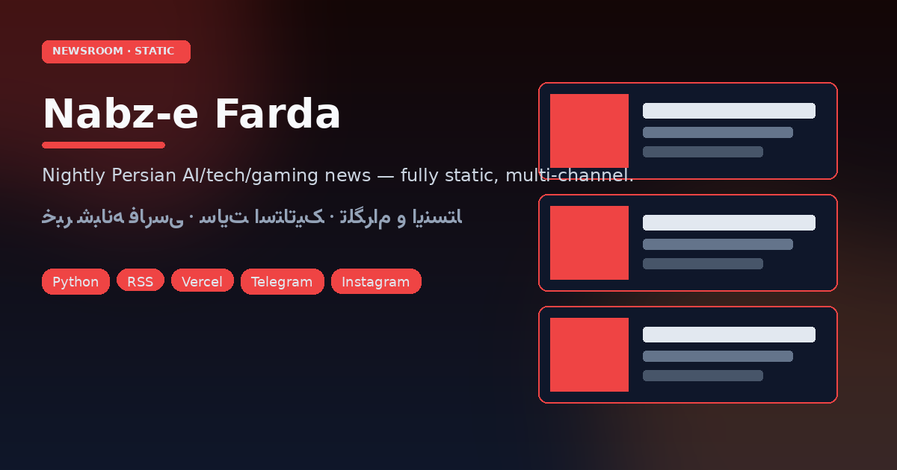
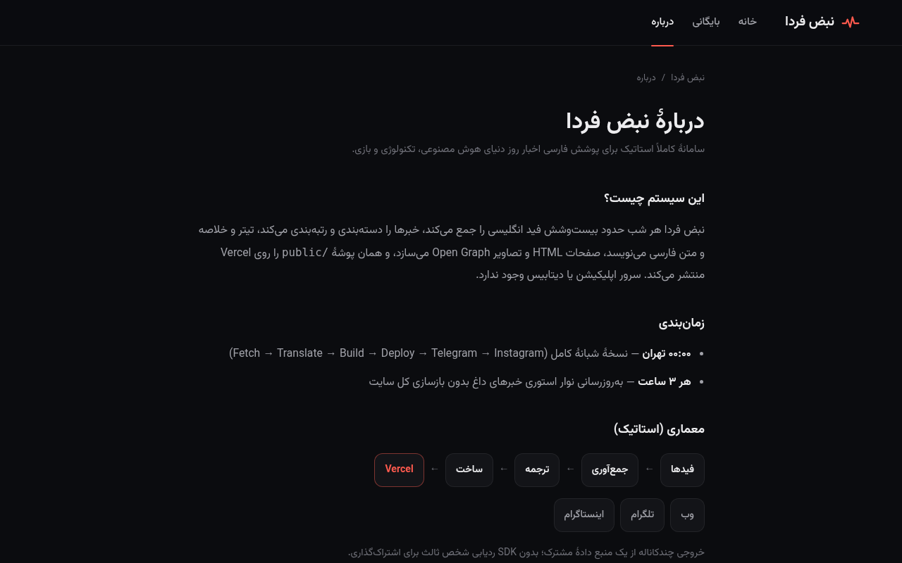

<p align="center">
  <a href="https://nabz-farda.vercel.app"></a>
</p>

<h1 align="center">نبض فردا · Nabz-e Farda</h1>

<p align="center">
  
</p>

<p align="center">
  
  
  
  
  
  
</p>

<p align="center">
  <a href="#فارسی">فارسی</a> · <a href="#english">English</a>
</p>

<p align="center">
  <em>خبر انگلیسی AI، فناوری و بازی — هر شب به فارسی، روی یک سایت کاملاً استاتیک.</em><br>
  <em>English AI, tech & gaming news — rewritten in Persian nightly as a fully static site.</em>
</p>

<p align="center">
  <a href="https://nabz-farda.vercel.app"><strong>Live</strong></a> ·
  <a href="https://nabz-farda.vercel.app/about/"><strong>About / judges</strong></a> ·
  <a href="https://nabz-farda.vercel.app/automation/"><strong>Automation</strong></a> <sub>(unlisted)</sub> ·
  <a href="https://www.instagram.com/nabz_farda/">Instagram</a> ·
  <a href="COMPETITION.md">COMPETITION.md</a>
</p>

<p align="center">
  <a href="https://nabz-farda.vercel.app">
    
  </a>
  <br><sub>Homepage · nabz-farda.vercel.app</sub>
</p>

<p align="center">
  
  <br><sub>About / judges walkthrough</sub>
</p>

---

<a id="فارسی"></a>

## فارسی

خوانندهٔ فارسی به لانچ‌های AI، خبر تراشه و اعلان بازی‌ها اهمیت می‌دهد — اما منابع اصلی انگلیسی‌اند و تحریریهٔ ۲۴ساعته در دسترس نیست. **نبض فردا** این فاصله را بدون سرور اپلیکیشن و بدون دیتابیس عمومی می‌بندد: هر شب حدود ۲۶ فید RSS را می‌گیرد، عنوان و خلاصه (و بدنه) فارسی می‌نویسد، و یک نسخهٔ استاتیک تازه روی Vercel منتشر می‌کند. هر سه ساعت یک گذر سبک‌تر نوار استوری را تازه نگه می‌دارد. همان دادهٔ روز، پست تلگرام و دارایی‌های ریل/کاروسل/استوری اینستاگرام را تغذیه می‌کند.

پوشهٔ `public/` همان وب‌سایت است.

### آنچه امروز واقعاً منتشر می‌شود

| سطح | واقعیت فعلی |
|---|---|
| **نسخه شبانه** | دریافت → حذف تکراری → دسته‌بندی (AI / تک / گیم) → رتبه‌بندی → `title_fa` / `summary_fa` / `body_fa` → رشد آرشیو روزانه |
| **مقالات استاتیک + سئو** | `/news/<date>/<id>`، صفحات روز و آرشیو؛ canonical، OG/Twitter، JSON-LD (`NewsArticle`, `BreadcrumbList`)؛ `sitemap.xml`، Google News sitemap، `robots.txt`، RSS 2.0 |
| **کارت OG** | ۱۲۰۰×۶۳۰ برای هر خبر (Pillow + شکل‌دهی صحیح فارسی)؛ کش تا فقط موارد جدید/تغییرکرده دوباره رسم شوند |
| **نوار استوری** | آیتم‌های فوری هر ۳ ساعت؛ حداکثر ۱۵ زنده، انقضای ۲۴ساعته سمت کلاینت؛ دیپ‌لینک `/#s=<id>` |
| **تجربه مقاله** | زمان مطالعه، اشتراک لینک/تلگرام/X (بدون SDK ردیابی)، مطالب مرتبط، **خلاصه** + **خبر کامل** |
| **جستجو** | `search-index.json` استاتیک، چیپ‌های صفحه اول، فیلتر زنده در `/search/` |
| **PWA** | مانیفست، سرویس‌ورکر سبک، صفحه آفلاین فارسی |
| **درباره + عملیات** | `/about/` برای داوران؛ داشبورد unlisted در `/automation/` روی `ops.json` زنده (نه در منوی اصلی) |
| **تلگرام** | حدود ۸ پست شبانه با تصویر OG + هشدار فوری؛ فایل state جلوی تکراری را می‌گیرد |
| **اینستاگرام** | ریل، کاروسل، استوری از JSON همان روز؛ Chrome بدون‌سر + ffmpeg؛ ساوندترک سنتزشده در کد |

**API عمومی محصول وجود ندارد.** JSONهای داخلی زیر `/data/` فقط جستجو و داشبورد عملیات را تغذیه می‌کنند.

**استک:** Python 3 (`feedparser`, `requests`, `beautifulsoup4`, `Pillow`) · HTML/CSS/JS دستی · Vercel استاتیک (`cleanUrls`) · Telegram Bot API · Playwright/Chrome + ffmpeg + NumPy · [Vazirmatn](https://github.com/rastikerdar/vazirmatn)

### دمو برای داوران (≈۵ دقیقه، بدون Credential)

| قدم | کجا | چه ببینید |
|---:|---|---|
| ۱ | [خانه](https://nabz-farda.vercel.app) | RTL تیره، نوار استوری، چیپ دسته، ورود جستجو |
| ۲ | هر کارت خبر | **خلاصه** / **خبر کامل**، زمان مطالعه، اشتراک، مرتبط |
| ۳ | [جستجو](https://nabz-farda.vercel.app/search/) | فیلتر سمت‌کلاینت روی ایندکس آرشیو |
| ۴ | [درباره](https://nabz-farda.vercel.app/about/) | معماری + زمان‌بندی؛ لینک به اتوماسیون |
| ۵ | [اتوماسیون](https://nabz-farda.vercel.app/automation/) *(unlisted)* | مراحل پایپ‌لاین + آمار زنده `ops.json` |

```bash
curl -s https://nabz-farda.vercel.app/data/ops.json | head
curl -s https://nabz-farda.vercel.app/data/search-index.json | head
curl -s https://nabz-farda.vercel.app/feed.xml | head
```

همچنین: [RSS](https://nabz-farda.vercel.app/feed.xml) · [اینستا `@nabz_farda`](https://www.instagram.com/nabz_farda/) · کانال تلگرام · [`COMPETITION.md`](COMPETITION.md) · [`docs/PRESENTATION.md`](docs/PRESENTATION.md)

### معماری

<p align="center">
  
</p>

| گام | اسکریپت | خروجی |
|---|---|---|
| فیدها | `scripts/feeds.json` | حدود ۲۶ منبع RSS |
| دریافت | `fetch_news.py` | `data/raw/DATE.json` |
| ترجمه | `translate.py` | `data/translations/DATE.json` |
| بیلد | `build.py` + `sitegen.py` | صفحات، OG، sitemap، RSS، ایندکس، `ops.json` |
| دیپلوی | `deploy_cli.sh` | `public/` → nabz-farda.vercel.app |
| انتشار | `telegram_post.py`, `insta/` | تلگرام؛ ریل/کاروسل/استوری |

نسخه شبانه (۰۰:۰۰ Asia/Tehran) و استوری (هر ۳ ساعت) هر دو همان `public/` را دیپلوی می‌کنند و هم‌پوشانی ندارند — اسلات نیمه‌شب مال نسخه کامل است.

### چیدمان مخزن

```
public/          # خودِ سایت (دیپلوی همان‌طور)
scripts/         # پایپ‌لاین fetch/translate/build/deploy/stories/telegram
config/          # chat id تلگرام (بدون توکن)
data/            # خام، ترجمه، state استوری/پست
insta/           # ژنراتورهای ریل/کاروسل/استوری
assets/          # اسکرین‌شات و SVG ریدمی
docs/            # ارائه مسابقه
COMPETITION.md · NIGHTLY.md
```

### شروع کار

**پیش‌نیاز:** Python 3.11+، Node (برای `npx vercel`). ابزار اینستا: Chrome، `ffmpeg`، Playwright.

```bash
git clone https://github.com/yasinfallahati/nabz-farda.git && cd nabz-farda
python3 -m venv .venv
.venv/bin/pip install feedparser requests beautifulsoup4 pillow
export VERCEL_TOKEN=... TELEGRAM_BOT_TOKEN=...
export NF_FONTS="$PWD/insta/assets/fonts"
cd public && npx vercel link --project nabz-farda && cd ..
.venv/bin/python scripts/build.py --pages-only
.venv/bin/python scripts/preview_server.py 8765
```

### ورک‌فلوها

Runbook کامل: [`NIGHTLY.md`](NIGHTLY.md).

**شبانه (۰۰:۰۰ تهران)**

```bash
DATE=$(TZ=Asia/Tehran date +%F)
scripts/nightly_prepare.sh "$DATE"   # fetch → translations JSON
# title_fa / summary_fa / body_fa را پر کنید
scripts/nightly_finish.sh "$DATE"    # validate → build → OG → sitemaps
bash scripts/deploy_cli.sh
.venv/bin/python scripts/telegram_post.py nightly "$DATE"
```

**استوری (هر ۳ ساعت)**

```bash
.venv/bin/python scripts/update_stories.py fetch
.venv/bin/python scripts/update_stories.py apply --deploy --telegram
```

### ابزار اینستاگرام

| اسکریپت | خروجی |
|---|---|
| `make_insta.py` | پکیج روزانه کاروسل + ریل + کپشن |
| `reel_v2.py` | ریل موشن در Chrome بدون‌سر |
| `reel_audio.py` | ترک ۱۲۰BPM بدون کپی‌رایت (NumPy) |
| `stories/make_story_cards.py` | کارت استوری ۱۰۸۰×۱۹۲۰ |
| `make_site_story.py` | استوری ۱۲ثانیه‌ای اسکرول سایت |

مدیا رندرشده gitignore است؛ فقط کد، spec، کپشن و فونت ترک می‌شود.

### پیکربندی و امنیت

- `scripts/feeds.json` · `config/telegram.json` (فقط chat id) · `public/vercel.json` · `data/og-manifest.json`
- **هیچ سکرتی در ریپو نیست.** توکن فقط از env؛ `.env*` و `.vercel/` نادیده گرفته می‌شوند.
- اگر Credential لو رفت، در Vercel/BotFather بچرخانید — فقط پاک‌کردن کامیت کافی نیست.

### مجوز

Copyright © 2026 Saman Yasin. **All rights reserved.**  
خبرها به ناشر اصلی لینک می‌دهند. تایپوگرافی: Vazirmatn (SIL OFL). میزبانی: Vercel.

---

<a id="english"></a>

## English

Persian readers care about AI launches, chip news, and game drops — but the sources that matter are English, and a 24/7 newsroom is out of reach. **Nabz-e Farda** (“Tomorrow’s Pulse”) closes that gap without a server or a database: every night it pulls ~26 RSS feeds, writes Persian headlines and summaries, and deploys a new static edition to Vercel. A lighter stories pass every three hours keeps the breaking-news bar fresh. The same day data feeds Telegram posts and Instagram reel / carousel / story assets.

The `public/` folder *is* the website.

### What ships

| Surface | Reality today |
|---|---|
| **Nightly edition** | Fetch → dedupe → categorize (AI / Tech / Gaming) → rank → Persian `title_fa` / `summary_fa` / `body_fa` → archive grows by one day |
| **Static articles + SEO** | `/news/<date>/<id>`, day pages, archive; canonical, Open Graph / Twitter cards, JSON-LD (`NewsArticle`, `BreadcrumbList`); `sitemap.xml`, Google News sitemap, `robots.txt`, RSS 2.0 |
| **OG cards** | 1200×630 per story (Pillow + Raqm for correct Persian shaping); cached so only new/changed items redraw |
| **Stories bar** | Scored breaking items every 3h; max 15 live, 24h client-side expiry; deep links `/#s=<id>` |
| **Article UX** | Reading-time, copy-link / Telegram / X share (no tracking SDKs), related stories, **خلاصه** + **خبر کامل** |
| **Search** | Static `search-index.json`, homepage chips, live filter at `/search/` |
| **PWA shell** | Web manifest, lightweight service worker, Persian offline fallback |
| **About + ops** | `/about/` for judges; unlisted `/automation/` dashboard reading live `ops.json` |
| **Telegram** | ~8 nightly photo posts with OG images + breaking alerts; state file prevents duplicates |
| **Instagram pipeline** | Reels, carousels, story cards from day JSON; headless Chrome + ffmpeg; soundtrack synthesised in code |

There is **no public API product surface**. Internal JSON under `/data/` powers search and the ops dashboard only.

**Stack:** Python 3 (`feedparser`, `requests`, `beautifulsoup4`, `Pillow`) · hand-written HTML/CSS/JS · Vercel static (`cleanUrls`) · Telegram Bot API · Playwright / Chrome + ffmpeg + NumPy · [Vazirmatn](https://github.com/rastikerdar/vazirmatn)

### Demo for judges

≈5 minutes, no credentials required — same five steps as the فارسی table above (Home → article → Search → About → Automation).

```bash
curl -s https://nabz-farda.vercel.app/data/ops.json | head
curl -s https://nabz-farda.vercel.app/data/search-index.json | head
curl -s https://nabz-farda.vercel.app/feed.xml | head
```

Contest notes: [`COMPETITION.md`](COMPETITION.md) · [`docs/PRESENTATION.md`](docs/PRESENTATION.md)

### Architecture

| Step | Script | Output |
|---|---|---|
| Feeds | `scripts/feeds.json` | ~26 RSS sources |
| Fetch | `fetch_news.py` | `data/raw/DATE.json` |
| Translate | `translate.py` | `data/translations/DATE.json` |
| Build | `build.py` + `sitegen.py` | pages, OG, sitemaps, RSS, search index, `ops.json` |
| Deploy | `deploy_cli.sh` | `public/` → production |
| Publish | `telegram_post.py`, `insta/` | Telegram; Instagram assets |

Nightly (00:00 Asia/Tehran) and stories (every 3h) both deploy the same `public/` folder and never overlap.

### Getting started

```bash
git clone https://github.com/yasinfallahati/nabz-farda.git && cd nabz-farda
python3 -m venv .venv && .venv/bin/pip install feedparser requests beautifulsoup4 pillow
export VERCEL_TOKEN=... TELEGRAM_BOT_TOKEN=... NF_FONTS="$PWD/insta/assets/fonts"
cd public && npx vercel link --project nabz-farda && cd ..
.venv/bin/python scripts/build.py --pages-only
.venv/bin/python scripts/preview_server.py 8765
```

### Workflows

Full runbook: [`NIGHTLY.md`](NIGHTLY.md).

```bash
DATE=$(TZ=Asia/Tehran date +%F)
scripts/nightly_prepare.sh "$DATE"
scripts/nightly_finish.sh "$DATE"
bash scripts/deploy_cli.sh
.venv/bin/python scripts/telegram_post.py nightly "$DATE"

.venv/bin/python scripts/update_stories.py fetch
.venv/bin/python scripts/update_stories.py apply --deploy --telegram
```

### Instagram tooling

`make_insta.py` · `reel_v2.py` · `reel_audio.py` · `stories/make_story_cards.py` · `make_site_story.py` — offline from day JSON; rendered media is git-ignored.

### Security & license

No secrets in the repository. Tokens from environment only. `config/telegram.json` holds chat IDs only. Copyright © 2026 Saman Yasin — All rights reserved. Sources retain rights to their reporting; Vazirmatn SIL OFL; hosted on Vercel.
