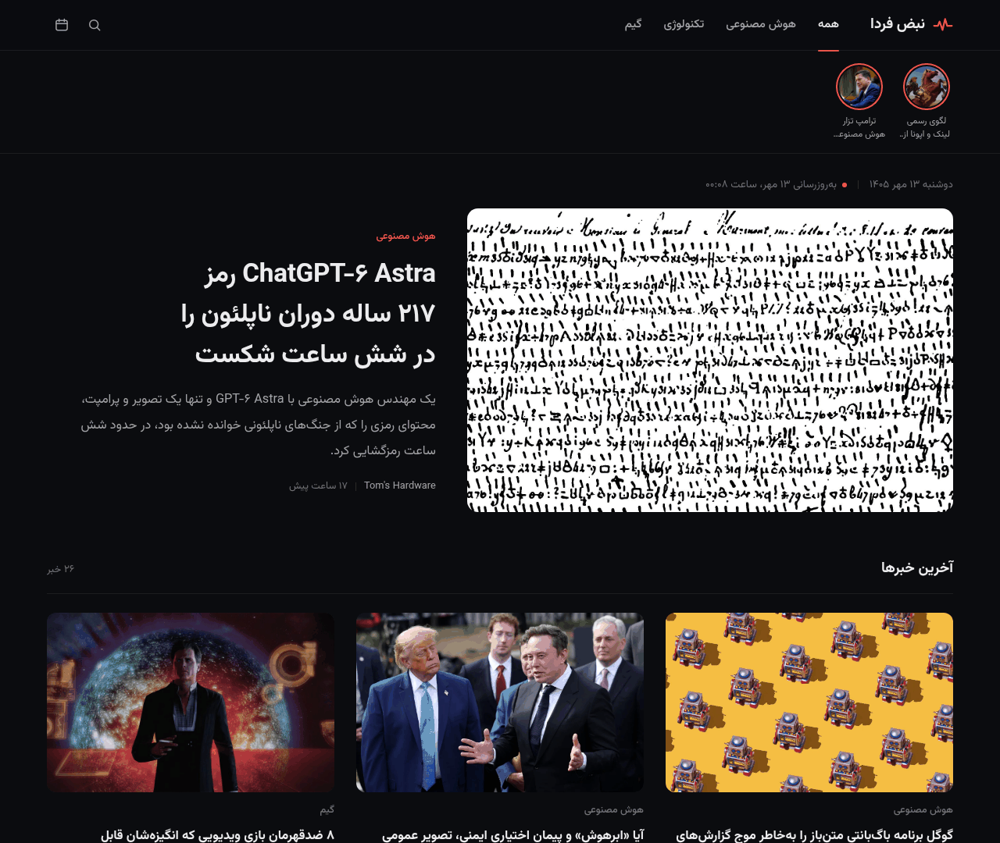
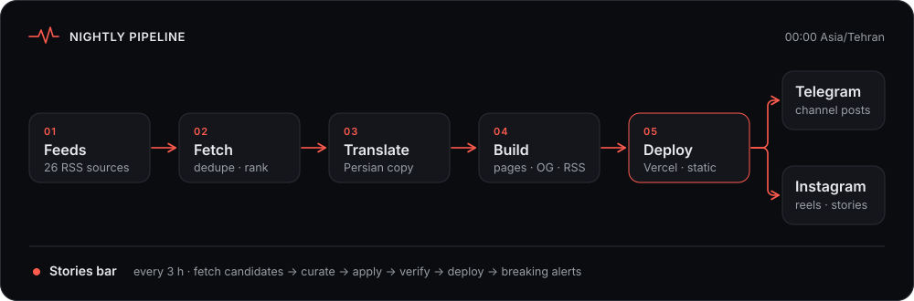

<p align="center">
  <a href="https://nabz-farda.vercel.app"></a>
</p>

<h1 align="center">Nabz-e Farda</h1>

<p align="center">
  <strong>A nightly, fully static Persian news site for AI, technology, and gaming — with Instagram and Telegram publishing.</strong>
</p>

<p align="center">
  <a href="https://nabz-farda.vercel.app"></a>
  <a href="https://www.instagram.com/nabz_farda/"></a>
  <a href="https://www.python.org/"></a>
  <a href="https://nabz-farda.vercel.app"></a>
  <a href="https://github.com/yasinfallahati/nabz-farda/commits/main"></a>
  <a href="#license"></a>
</p>

<p align="center">
  <a href="https://nabz-farda.vercel.app">
    
  </a>
  <br>
  <sub>Homepage · <a href="https://nabz-farda.vercel.app">nabz-farda.vercel.app</a></sub>
</p>

## &nbsp;Table of contents

- [Overview](#overview)
- [Features](#features)
- [Live demos](#live-demos)
- [Tech stack](#tech-stack)
- [Architecture](#architecture)
- [Repository structure](#repository-structure)
- [Getting started](#getting-started)
- [Workflows](#workflows)
- [Instagram tooling](#instagram-tooling)
- [Configuration](#configuration)
- [Security](#security)
- [Competition showcase](#competition-showcase)
- [Roadmap](#roadmap)
- [Contributing](#contributing)
- [License](#license)
- [Acknowledgements](#acknowledgements)

## &nbsp;Overview

Nabz-e Farda ("Tomorrow's Pulse") collects the day's most important AI, tech, and gaming stories from about 26
English-language sources, writes a Persian headline and summary for each one, and publishes them as a fast, static,
SEO-friendly website.

The pipeline runs once every night (00:00 Asia/Tehran). A lighter "stories" pass every three hours keeps breaking news
fresh in between. The same content feeds a Telegram channel and a set of Instagram reel, carousel, and story generators.

There is no application server and no database. The `public/` folder *is* the website, and it deploys to Vercel as-is.

## &nbsp;Features

-  **Nightly news edition.** Fetches, de-duplicates, categorizes (AI / Tech / Gaming), and ranks stories, then adds
  Persian headlines and summaries. A new day is appended to a growing archive every night.
-  **Static article pages and SEO.** One page per story at `/news/<date>/<id>`, plus day pages and an archive. Each page
  carries canonical URLs, Open Graph / Twitter metadata, and JSON-LD (`NewsArticle`, `BreadcrumbList`). The build also
  writes `sitemap.xml`, a Google News sitemap, `robots.txt`, and an RSS 2.0 feed.
-  **Generated Open Graph images.** A 1200×630 social card for every story, rendered with Pillow + Raqm for correct
  Persian shaping. Cards are cached, so only new or changed stories are redrawn.
-  **Stories bar.** An Instagram-style row of breaking stories under the header. Candidates are scored on signals such as
  multi-outlet coverage, launches, breaches, and lawsuits. Each story expires after 24 hours (15 live at most) in the
  browser, so expiry never needs a deploy. Deep links use `/#s=<id>`.
-  **Telegram publishing.** About eight nightly picks go out as photo posts with their OG images, plus links back to the
  article and the original source. Breaking stories get short alert posts. A state file guarantees nothing is posted
  twice.
-  **Instagram tooling.** Motion-graphics reels, carousels, and story cards rendered from any day's data. Headless Chrome
  handles Persian typography; ffmpeg handles video. The soundtrack is synthesised in code, so there is no copyright
  issue with stock music.
-  **Ops dashboard.** Persian `/automation/` page with pipeline stages and live stats from `public/data/ops.json` (nightly date, category counts, stories, Telegram, feeds, commit).
-  **Search + category chips.** Static `search-index.json`, homepage chips, and `/search/` for live client-side filtering across the archive.
-  **Article upgrades.** Reading-time estimate, copy-link / Telegram / X share (no tracking SDKs), three related articles, plus خلاصه and خبر کامل.
-  **Public static API.** `/api/v1/latest.json`, `archive.json`, `ops.json`, and `openapi.json`, documented at `/api/`.
-  **PWA shell.** Web manifest, lightweight service worker, Persian offline fallback.
-  **About / judges page.** `/about/` explains nightly + 3h automation, static architecture, and demo links.
-  **Privacy-friendly analytics.** Vercel Web Analytics on every page.

## &nbsp;Live demos

| | |
|---|---|
| Website | https://nabz-farda.vercel.app |
| Automation dashboard | https://nabz-farda.vercel.app/automation/ |
| About / judges | https://nabz-farda.vercel.app/about/ |
| Public API | https://nabz-farda.vercel.app/api/ · [`latest.json`](https://nabz-farda.vercel.app/api/v1/latest.json) |
| Search | https://nabz-farda.vercel.app/search/ |
| RSS feed | https://nabz-farda.vercel.app/feed.xml |
| Sample article | https://nabz-farda.vercel.app/news/ (pick any day) |
| Instagram | https://www.instagram.com/nabz_farda/ |
| Telegram | Channel *Nabz-e Farda* · bot `@Nabz_farda_bot` |

## &nbsp;Tech stack

| Layer | Tools |
|---|---|
| Pipeline | Python 3 (`feedparser`, `requests`, `beautifulsoup4`, `Pillow`) |
| Frontend | Hand-written HTML, CSS, and vanilla JavaScript — no framework, no bundler |
| Hosting | Vercel static hosting (`cleanUrls`), deployed with the Vercel CLI or API |
| Social | Telegram Bot API |
| Media | Headless Chrome / Playwright, ffmpeg, NumPy (audio synthesis) |
| Typography | [Vazirmatn](https://github.com/rastikerdar/vazirmatn) (SIL Open Font License) |

## &nbsp;Architecture

<p align="center">
  
</p>

| Step | Script | Output |
|---|---|---|
| 01 Feeds | `scripts/feeds.json` | ~26 RSS sources across AI, tech, and gaming |
| 02 Fetch | `fetch_news.py` | `data/raw/DATE.json` — de-duplicated, categorized, ranked |
| 03 Translate | `translate.py` | `data/translations/DATE.json` — Persian headline + summary per item |
| 04 Build | `build.py` + `sitegen.py` | Day data, article pages, OG images, sitemaps, RSS |
| 05 Deploy | `deploy_cli.sh` | `public/` → https://nabz-farda.vercel.app |
| Publish | `telegram_post.py`, `insta/` | Telegram posts; Instagram reels, carousels, stories |

The nightly and stories paths both deploy the same `public/` folder. They never run at the same time — the 00:00 slot
belongs to the nightly edition.

## &nbsp;Repository structure

```
.
├── public/                 # The website (deployed to Vercel as-is)
│   ├── index.html          # Home: category tabs, stories bar, hero, story list
│   ├── assets/             # CSS, JS, icons
│   ├── data/               # days/, archive, stories, ops, search-index
│   ├── api/                # Public static JSON API + docs
│   ├── automation/, about/, search/
│   ├── news/               # Generated article, day, and archive pages
│   ├── og/                 # Generated Open Graph images
│   ├── manifest.webmanifest, sw.js, offline.html
│   ├── sitemap.xml, sitemap-news.xml, feed.xml, robots.txt
│   └── vercel.json
├── scripts/                # Pipeline
│   ├── feeds.json          # Source feeds (name, URL, category, limits)
│   ├── fetch_news.py       # Step 1 — fetch, de-dupe, categorize, select
│   ├── translate.py        # Step 2 — export / validate the translation file
│   ├── build.py            # Step 3 — merge day data + archive, then sitegen
│   ├── sitegen.py          #         article pages, OG images, sitemaps, RSS
│   ├── deploy_cli.sh       # Step 4 — deploy public/ with the Vercel CLI
│   ├── deploy_payload.py   #         alternative: payload for the Vercel API
│   ├── telegram_post.py    # Step 6 — nightly picks and breaking alerts
│   ├── update_stories.py   # Stories bar: fetch → apply → verify → deploy
│   ├── nightly_prepare.sh  # Wrapper for steps 1–2
│   ├── nightly_finish.sh   # Wrapper for steps 2b–4a
│   └── preview_server.py   # Local preview (mimics cleanUrls)
├── config/telegram.json    # Telegram chat IDs only (no credentials)
├── data/                   # Raw items, translations, applied stories, post state
├── deploy/                 # Generated deploy artifacts (git-ignored)
├── insta/                  # Instagram reel / carousel / story generators
├── assets/                 # README screenshot + SVG artwork (assets/svg/)
├── redesign/               # Design notes
└── NIGHTLY.md              # Full operational runbook
```

## &nbsp;Getting started

### &nbsp;Prerequisites

- Python 3.11+
- Node.js (for `npx vercel`)
- For the Instagram tooling: Google Chrome or Chromium, `ffmpeg`, and Playwright

### &nbsp;Clone and install

```bash
git clone https://github.com/yasinfallahati/nabz-farda.git
cd nabz-farda

python3 -m venv .venv
.venv/bin/pip install feedparser requests beautifulsoup4 pillow
```

### &nbsp;Environment variables

| Variable | Required for | Description |
|---|---|---|
| `VERCEL_TOKEN` | Deploys | Vercel access token used by `scripts/deploy_cli.sh` |
| `TELEGRAM_BOT_TOKEN` | Telegram posts | Bot token for the channel bot |
| `NF_FONTS` | Optional | Directory with the Vazirmatn TTFs used for OG images (use `insta/assets/fonts` in this repo) |

```bash
export VERCEL_TOKEN=...
export TELEGRAM_BOT_TOKEN=...
export NF_FONTS="$PWD/insta/assets/fonts"
```

### &nbsp;Link the Vercel project

The `.vercel/` link file is intentionally not committed. Link `public/` to the `nabz-farda` project once:

```bash
cd public
npx vercel link --project nabz-farda
cd ..
```

### &nbsp;Preview locally

```bash
.venv/bin/python scripts/build.py --pages-only     # regenerate the static layer from existing data
.venv/bin/python scripts/preview_server.py 8765    # open http://localhost:8765/
```

> Some scripts still assume the production layout under `/workspace/news-site` and `/workspace/insta`.
> Adjust paths (or set `NF_FONTS`) when running elsewhere.

## &nbsp;Workflows

`NIGHTLY.md` is the complete runbook. The summary below covers the main steps.

### &nbsp;Nightly edition (00:00 Asia/Tehran)

```bash
DATE=$(TZ=Asia/Tehran date +%F)

scripts/nightly_prepare.sh "$DATE"     # 1. fetch feeds, export data/translations/$DATE.json
#                                        2. fill title_fa / summary_fa for each item (editorial / AI step)
scripts/nightly_finish.sh "$DATE"      # 3. validate translations, build data, pages, OG images, sitemaps, feed
bash scripts/deploy_cli.sh             # 4. deploy public/ to production
curl -s https://nabz-farda.vercel.app/data/archive.json | head -c 200   # 5. verify "latest" == $DATE
.venv/bin/python scripts/telegram_post.py nightly "$DATE" --dry-run     # 6. review picks
.venv/bin/python scripts/telegram_post.py nightly "$DATE"               #    then post
```

Every day keeps its own `public/data/days/<date>.json`, so the archive grows automatically. A missed night can be
rebuilt by running the same steps with that date.

### &nbsp;Stories bar (every 3 hours)

```bash
.venv/bin/python scripts/update_stories.py fetch                       # score candidates → data/stories/pending.json
#                                                                        keep only truly notable items, add Persian text
.venv/bin/python scripts/update_stories.py apply --deploy --telegram   # merge, verify site, deploy, alert
```

`apply` checks the whole site in a scratch copy before deploying. It skips the deploy when nothing new was added, and
it confirms the new stories are live before posting breaking alerts. The 00:00 slot is left to the nightly run.

## &nbsp;Instagram tooling

All Instagram tooling lives in `insta/`. Everything renders offline from a day's JSON, except for downloading article
images.

| Script | Output |
|---|---|
| `make_insta.py` | Daily package: 1080×1350 carousel, 1080×1920 reel, and caption. Supports hand-picked stories (`--ids`) and one-story "hook" reels (`--single`). |
| `reel_v2.py` | Motion-graphics reel renderer. A deterministic JS timeline is rendered frame by frame in headless Chrome, with cuts synced to the beat. |
| `reel_audio.py` | Copyright-free 120 BPM track plus whoosh and impact effects (NumPy). |
| `stories/make_story_cards.py` | Static 1080×1920 story cards from a small JSON spec. |
| `make_site_story.py` | 12-second looping story that scrolls the live site inside a phone mockup. |
| `send_to_telegram.py` | Sends rendered media to the owner chat for review. |

```bash
cd insta
python3 make_insta.py ../public/data/days/2026-10-05.json --n 6 --out out/2026-10-05
python3 stories/make_story_cards.py stories/2026-10-04-evening/spec.json out/story
```

Rendered media (MP4, PNG, JPG, frames, QC images) is git-ignored. Only code, specs, captions, and fonts are tracked.

## &nbsp;Configuration

| File | Purpose |
|---|---|
| `scripts/feeds.json` | RSS sources: name, URL, default category, optional limits / keyword filters |
| `config/telegram.json` | Telegram `chat_id` (channel) and `owner_chat_id` — no tokens |
| `public/vercel.json` | `cleanUrls`, content-type for the RSS feed, cache headers for `/og/*` |
| `data/og-manifest.json` | Cache of rendered OG images (hash → path); bump `OG_VERSION` in `sitegen.py` to force a redraw |
| `.gitignore` | Keeps `.env*`, `.vercel/`, deploy state, screenshots, and rendered media out of git |

Useful knobs on the scripts:

- `fetch_news.py --hours` / `--per-cat` / `--max-per-source`
- `update_stories.py fetch --hours` / `--max` / `--min-score`
- `telegram_post.py nightly --max` / `--exclude` / `--id`

## &nbsp;Security

- **This repository contains no secrets.** Tokens are read only from environment variables and are never printed;
  `telegram_post.py` removes the token from any error output.
- `.env*`, `.vercel/`, deploy state, and cookies are covered by `.gitignore`.
- `config/telegram.json` holds only chat IDs.
- If a credential is ever exposed, revoke and rotate it in Vercel or BotFather. Do not just delete the commit.

## &nbsp;Roadmap

Honest near-term work — not a promise of delivery dates:

- **Designer logo.** The current pulse mark is a placeholder; a designer-made brand logo is pending.
- **Instagram Graph API.** Meta's Graph API is not reachable from Iran, so publishing currently goes through a browser
  session rather than the official API. A Graph API path will be added when a reachable environment is available.
- **Trial reels.** Instagram Trial Reels require about 200 followers; A/B-style trial reels will start once the account
  reaches that threshold.
- **Source reliability.** Keep pruning quiet or broken feeds and tuning the stories scoring keywords.

## &nbsp;Contributing

Issues are welcome — bug reports, feed suggestions, and design notes are especially useful.

Pull requests are welcome for this public repository. Please keep changes focused, do not commit secrets or generated
media, and open an issue first for larger design or pipeline changes. By contributing you agree that your work is
submitted under the same terms as the rest of this repository (see [License](#license)).

## &nbsp;License

Copyright © 2026 Saman Yasin. **All rights reserved.**

No permission is granted to copy, modify, or redistribute this code or content without written consent, except as
allowed by the licenses of third-party components listed below. News headlines and summaries link back to their
original publishers, who retain the rights to their reporting.

## &nbsp;Acknowledgements

- **Sources.** Stories are curated from English tech and gaming outlets including The Verge, TechCrunch, Ars Technica,
  Wired, Engadget, Tom's Hardware, Hacker News, IGN, GameSpot, Polygon, Eurogamer, PC Gamer, Kotaku, Rock Paper Shotgun,
  Gematsu, VentureBeat, MIT Technology Review, OpenAI, Google AI, Google DeepMind, and Hugging Face. Each item links to
  the original article.
- **Typography.** [Vazirmatn](https://github.com/rastikerdar/vazirmatn) by Saber Rastikerdar, distributed under the
  [SIL Open Font License 1.1](https://scripts.sil.org/OFL).
- **Hosting.** Deployed on [Vercel](https://vercel.com).
